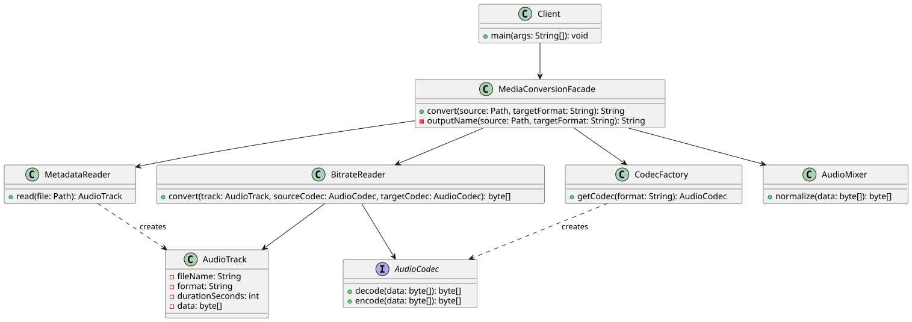

# Assignment 4: Media conversion facade

**Course:** Software Design Patterns (ShP-2216)  
**Student:** Assemgazy Olzhas, SE-2528

## 1. Introduction

This project uses the Facade pattern for a simulated media conversion process. Converting a file involves several steps: reading its metadata, selecting codecs, processing the bytes, normalizing the result, and writing an output file. A client that performs each step directly would need to know the details and their order. `MediaConversionFacade` provides one `convert` method to coordinate the process.

The example accepts `wav`, `mp3`, and `flac` as format labels. The codec operations work on byte arrays and simulate conversion steps. They do not implement real audio formats, so the resulting files are not playable audio.

## 2. UML class diagram



The `Client` calls `MediaConversionFacade`. The Facade coordinates the subsystem classes shown in the diagram. Those classes do not refer back to the Facade and remain available for direct use.

## 3. Clean Code principles

### 3.1 Meaningful names

Names such as `MetadataReader`, `AudioMixer`, and `normalize` describe what each part does.

```java
byte[] normalized = audioMixer.normalize(converted);
```

### 3.2 Single responsibility

`AudioMixer` normalizes byte values. It does not read a file or choose a codec.

```java
public byte[] normalize(byte[] data)
```

### 3.3 A small Facade API

The public method accepts only the source path and target format. The caller does not need to build an `AudioTrack` or select codecs.

```java
public String convert(Path source, String targetFormat) throws IOException
```

### 3.4 Encapsulation and independent subsystem classes

The Facade keeps its subsystem objects private. Subsystem classes have no reference to the Facade, so advanced clients can also call them directly.

```java
private final MetadataReader metadataReader = new MetadataReader();
private final CodecFactory codecFactory = new CodecFactory();
```

### 3.5 Error handling

`MetadataReader` reports a missing source file with an `IOException`. The Client catches conversion errors and prints a message.

```java
if (!Files.isRegularFile(file)) {
    throw new IOException("Source file does not exist: " + file);
}
```

## 4. Conclusion

The Facade hides the order of metadata reading, codec selection, byte adjustment, normalization, and file writing. It gives the Client one method for the full process. The subsystem classes remain separate and can be used directly when lower-level control is needed.

**GitHub repository:** [Link to repo](https://github.com/iuve1n/SDP_Assignment4.git).
